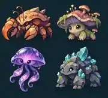

# Four creature concept studies — 2026-11-27

User liked this original AI-generated pixel-art style study. Archive only, not approved as final game style and not a Pixel Composer output. The four concepts are armored crab, mushroom companion, luminous jellyfish, and crystal golem. Preserve species-specific silhouettes and use the full sheet as reference for later production.

The committed WebP is a 180×164 lossy preview. Full-resolution source PNG (1312×1199, 1,568,252 bytes) remains in the originating ChatGPT conversation; SHA-256 `34670b6eb36eee6048376558e56e210f298276053d0df057f37e96f781b9109f`. Upload the unchanged PNG as `creature-sheet-original.png` when a binary upload path is available. This preview must not replace the original or be imported as game art. No transparent sprites, animation or engine validation yet.

Pixel Composer pilot: official distribution only, isolated offline rendering without GitHub/SSH/API credentials; do not execute untrusted Shell/Lua nodes, Workshop projects or third-party extensions. Export PNG only. Keep the established painterly direction until an explicit style comparison is accepted. Do not install into the current automation environment without validating isolation and availability.
