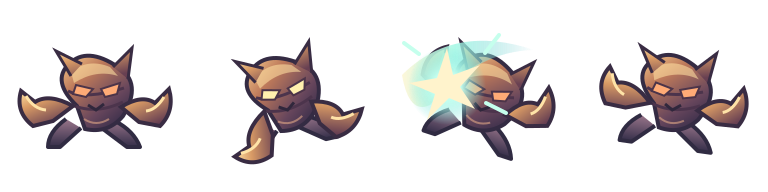

# DESIGN-002 — Amber Mantis combat readability
2026-11-25 · PROPOSED, not integrated. Base main observed 9a17b61455d6ea779a263dac7a71222bddb7af24. Existing Veilwood discovery PR is distinct; this addresses combat P0 instead.

Original gradient-shaded vector study, not a finished hand-painted raster asset. Amber armored alien with angular eyes, claws and segmented shell deliberately contrasts the rounded friendly Nooli. Four poses: idle, windup, hit recoil with illustrative contact burst, recovery. Separate cue strip: dashed coral danger ring, mint/cream contact burst, translucent whiff arc. No external images or commercial assets. Project-original artwork.

References (cached ART_DIRECTION and combat row of DESIGN_REFERENCE_ROUTER; no new source image inspection): [Odin Sphere](https://atlus-vanillaware.jp/) — strong pose contrast and layered lighting; [Absolum](https://playabsolum.com/) — readable anticipation/contact/recovery. No traced frames or copied designs.

## Technical handoff
- Enemy strip 768×192, four 192×192 cells, transparent SVG, pivot (96,112) corresponds to current enemy position. Target scale 0.5 logical pixels/source pixel; body ~45–65 logical px including claws. Keep collision and health bar independent. Mirror horizontally only if facing logic warrants.
- Cue strip 576×192, three 192×192 cells, center (96,96). Danger ring radius 74 source pixels, scale 0.5 gives existing 37 logical px radius (large enemy 46 requires scale 46/74). The danger cue is anchored at target, not enemy. Existing hit radius differs from warning radius; developer should reconcile/test separately, not silently change collision.
- Existing scripts/sf_belt_scroll.gd: telegraph 0.72/0.90s, stagger 0.22s, flash 0.16s, impact_pause 0.055s, attack_fx 0.16s. Use idle→windup during telegraph, recoil only on confirmed damage, recovery after stagger. The illustrated burst in enemy pose is a reference composite; remove it from production enemy raster if using separate contact cue. Whiff arc must never display hit spark. Contact cue duration suggested 0.10–0.16s, preserve input responsiveness. Do not introduce additional attack windup latency.
- SVGs contain gradients, no external dependencies, transparent root. Export each cell to transparent PNG at native resolution, linear filtering, inspect engine import. PNG not supplied by this text-only repository write. No pixel grid constraint for this painterly direction.
- Palette amber #f8ce8e / plum #332b48, danger coral #f59a87, confirmed hit cream #fff6d4 / mint #a2f8e5. Shape distinctions (dashed circle vs starburst vs arc) supplement color.
- 360×640 and 393×852: current logical layout scales uniformly; expected enemy size ~45–65 logical px, ~49–71 physical px at 393 width if width-limited. Keep FX inside combat field and below HUD; no touch-target changes. These are calculated sizes, not screenshots or device tests.
- Source sizes: enemy 7043 characters, cues 1790 characters. No raster rendering, actual mobile/child playtest, Godot import or animation timing validation performed. The poses are discrete state illustrations, not a finished animation. Subjective hit feel remains unverified.

Next development action: integrate one confirmed-hit vs whiff comparison for a single enemy, export/rasterize separate assets, verify no false hit effects on miss/dodge and compare recorded gameplay with previous version. Do not merge as completed gameplay. No scripts, scenes, tests or main modifications.
