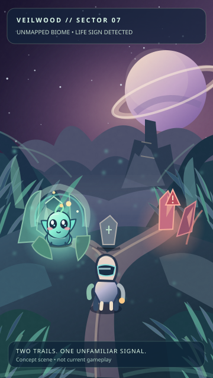

# DESIGN-001 — Veilwood: alien life-sign discovery

> **2026-11-25 / 3-hour design automation (manual immediate trigger)** · **PROPOSED / not integrated**. [Approved Art Bible](../ART_DIRECTION.md) · [Scene-specific Reference Router](../DESIGN_REFERENCE_ROUTER.md) · [Player P0 Feedback](../SF_PLAYTEST_FEEDBACK.md)

## Actual visual deliverables (original art, source included)

**1) Portrait exploration scene mockup, 360 × 640 SVG**

[Open original SVG](../../assets/design-proposals/veilwood-discovery/veilwood_discovery_scene.svg)

**2) Original recruitable alien creature “Nooli”, 3 expressions, transparent 384 × 128 SVG**

[Open transparent 3-frame sprite source](../../assets/design-proposals/veilwood-discovery/veilwood_companion_3state.svg)

This is original code-authored vector concept art, **not AI-generated photographic concept art** and not copied screenshots. No existing commercial game assets, trademarks, characters, music, or image textures were embedded.

## Problem → scene experiment

**User P0:** The current SF alpha lacks discovery and exploration excitement. A level must offer visible choices, not just waves.

**Design hypothesis:** A portrait 2D stage can suggest a **fork between a luminous turquoise cove on the left (unknown living signal)** and **a risky pink/red crystal approach on the right** using *shape + light* rather than instructional buttons. A large, gentle-eyed alien friend behind leaves can produce the impulse to approach/recruit instead of kill. This is a **visual proposal**, not playable branch implementation.

- **Left fork:** safe-looking soft turquoise bioluminescence; cove arch and shy creature behind partial vegetation; no textual “SAFE” indicator.
- **Right fork:** hazard via red spires/cracked sentry; contrast with gentle left light and foreshadow danger.
- **Center:** small human player with helmet and direction toward fork, pale stone marker; main interaction remains visible.
- **Far → mid → gameplay → foreground:** planetary ring, misty mountain silhouette, alien canopy, actual fork, near leaves/spores. All are grouped separately by SVG group IDs for possible layering.
- **Overlay:** top location and bottom short discovery line in **concept preview only**; omit from imported scene/replace with existing in-game HUD and mobile-friendly typography.

## Reference routing (only 3 targeted)

- [Odin Sphere / Vanillaware official](https://atlus-vanillaware.jp/): **principle** of lush painterly 2D background layers, theatrical light and staged fantasy depth. No specific compositions, sprite designs or motifs copied.
- [13 Sentinels official](https://atlus.com/13sentinels/lang/uk/): **principle** of mysterious environment lighting and character-vs-background atmosphere in a sci-fi-inflected 2D stage. No content replicated.
- [Monster Sanctuary official](https://monster-sanctuary.com/): **principle** that collectible species communicate personality and gameplay identity with silhouettes. “Nooli” is an original companion with face and shape informed broadly by *Kindchenschema*, not an existing monster re-skin.

Kindchenschema here is the **designer's hypothesis** about big eyes, plump forehead and short limbs, not a scientifically optimized perfect ratio or evidence of observed player attachment.

## Source details / dev handoff

| Element | Source | Intended integration / notes |
| --- | --- | --- |
| Scene | `assets/design-proposals/veilwood-discovery/veilwood_discovery_scene.svg` | 360×640, full-color vector, grouped `far`/`mid`/`gameplay`/`foreground`, `discoverable-creature`, `hero-marker`, and `frame-overlay`; draw order part of source |
| Nooli creature | `assets/design-proposals/veilwood-discovery/veilwood_companion_3state.svg` | 384×128 transparent SVG strip, **3 frames × 128×128** (idle / curious / rescued), center near 64,80; intended preview/in-game logical display about **48–64 px tall** after raster export |
| Palette | Within SVG `defs` | Dark mulberry nebula `#17122d`, twilight violet `#493759`, pale turquoise creature `#9bf4d7`, warm signal `#ffe0a0`, hazard coral `#c56c81` — **proposal only** |
| Rendering | Scene SVG with gradients, filters and procedural foliage | **Not a promise that Godot's SVG importer supports all SVG filters.** Rasterize to PNG per layer/frame at target 2× or 3× size and inspect browser/phone rendering before integration. Choose consistent linear filtering for painterly sprite layers; do not mix unplanned nearest/linear |
| Animation | Nooli 3 static expression frames | Narrative expression keyframes, **not a validated sprite animation**. Developer can derive blink/wave/interact in Godot, but must test actual animation timing, collision pivot and input |
| Licensing | Original artwork created for this project | No third-party image/texture embedded in either SVG; the linked reference games retain their original owners' copyrights |

## Explicit integration contract (for the hourly development session)

1. **Do not merge this design PR directly as gameplay complete.** It carries source assets and notes only; `scripts/`, `tests/`, `scenes/`, `project.godot`, `main`, `legacy/*` all untouched.
2. When implementing **two genuine selectable exploration routes** on a planet, open this PR, export/rasterize separate layers (or redraw game-optimized parts) and place the visible safe cove vs dangerous crystals **behind interactive collision/path logic**. No fake branching screens.
3. When implementing **recruitable Nooli**, connect hidden sighting → approach/interact → distinct rescue feedback → crew/cargo state and visible ship-return effect; visual alone cannot satisfy the P0 discovery/companion mechanic.
4. Check at **360×640 and 393×852**; the creature and the two routes must be discoverable within actual game viewing area. Layer contrast must not obscure telegraphed attacks; decorative spores must not look like damage indicators.
5. Only after Godot import + CI + web export + human mobile comparison should this progress to `INTEGRATED` / `PLAYTESTED`. If Godot SVG filters cannot render correctly, rasterize or simplify them before shipping.

## Verification performed / limitations

- ✓ Created two self-contained SVG source files with explicit sizes, layer IDs, three distinct companion expressions, no external bitmap or font dependency in art.
- ✓ Checked target coordinates against the source's portrait 360×640 canvas: left discovery approximately (99,392), right hazard approximately (289,383), tiny hero (179,494).
- ✓ Source-only PR; existing gameplay implementation and old fruit branch unaffected.
- **Not yet validated:** rendered PNG screenshot under engine, Android/iOS hardware, live touch readability, SVG filter compatibility, 7-year-old first-play performance, player discovery rate, subjective art charm or combat impact.

**Next development integration task (one only):** Build an actual two-way exploration choice that feeds different rewards in campaign state. Use this scene as an art reference/proposal; keep the gameplay meaningful even before importing the art.
