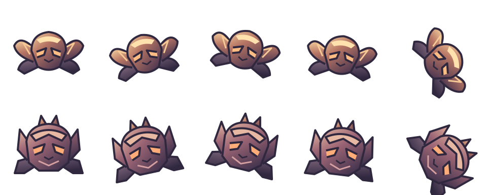

# Enemy identity repair — 2026-11-26
Baseline main 29a0537dc1462a1da728ac55ed4502c1308746fd. #11/#12 already added hero motion, discovery and charge; do not redo. Remaining actual source gap: paint_enemy renders kind 1/2 as colored circles, paint_fallen always draws MANTIS even for other kinds. This proposal fixes identity continuity, not combat mechanics.

## Integration
960×384 transparent SVG, 192×192 cells, row 0 kind 1 (broad wing-like shell), row 1 kind 2 (crowned heavy armor). Columns idle, anticipation, recoil, recovery, defeat. Pivot (96,112) per cell. Source gradients and outlines follow current original Amber Mantis palette; no external art. Project-original, same project licensing; no separate third-party dependency. Linear filter. Use 96 logical px for kind 1 and 120 for kind 2, same collision and existing 42/52 warning radius. Frame region Rect2(col*192,(kind-1)*192,192,192). Position p - Vector2(size/2,size*112/192). Keep warning/contact cues separate. During charge use anticipation pose and existing direction trail, do not stretch anatomy. Fallen uses col 4 and same species row; preserve existing 0.40s fade and reward logic. Kind 0 remains current Mantis. Do not change damage, input or enemy counts.

## Acceptance and limits
At 360×640: 96/120 logical px sprites; at 393×852 width-limited scale 1.0917, about 105/131 physical px, letterbox vertically. Calculated, not captures. Compare same wave before/after at both sizes; ensure no HP bar overlaps crown, no clipping into adjacent atlas cells, no collision changes, no hit spark on whiff, defeated kind matches living kind. Existing original Mantis is style anchor, no external images used. Cached reference principles Odin Sphere layered shading and Absolum pose readability; no fresh footage inspected. Reject color-swapped circles and Mantis corpse reuse; reject treating rigid rotation as finished animation. These are gradient-vector key poses, not finished painterly animation; U-004 silhouette sheet for three companions and actual game A/B still outstanding. Remote content equality checked; Godot import, raster appearance, real mobile/audio and human play unverified. Status PROPOSED. #13 capture scaling fix is dev-owned; use its corrected capture pipeline after integration.
