# VOID CARAVAN — 시각적 설명 도식 아틀라스
> 대화에 표시된 설명용 그림을 기반으로 **새로 재구성한 자체 SVG**. 원본 채팅의 SVG 픽셀 단위 복제나 완성 인게임 콘셉트 아님. 저장소 상대 경로로 보존되어 세션 종료 후에도 조회 가능. 영문 라벨은 이미지 렌더링 호환성 목적. GDD의 승인된 방향과 미결 사항을 설명한다.

## 01. 01-world-layers
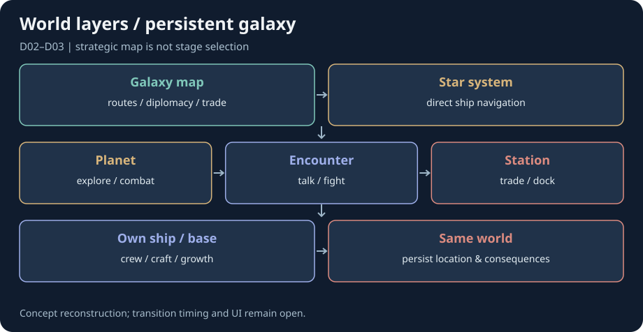

## 02. 02-faction-life
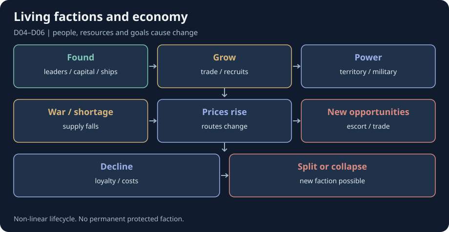

## 03. 03-ship-controls

## 04. 04-discovery-loop

## 05. 05-encounter
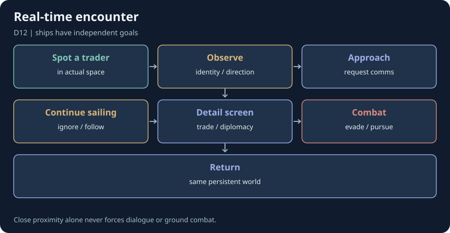

## 06. 06-damage

## 07. 07-combat-outcomes

## 08. 08-defeat

## 09. 09-fleet
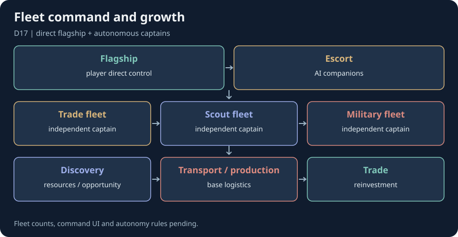

## 10. 10-planet-exploration
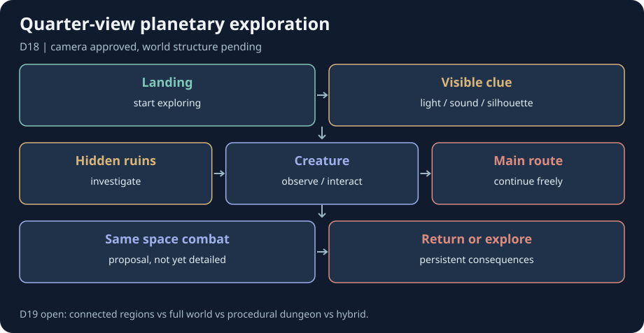

## 11. 11-information

## 12. 12-camera-comparison
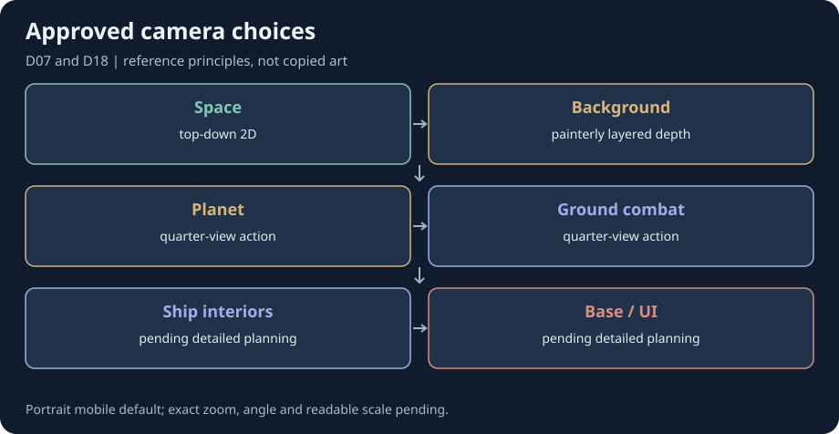

## 공간 배치 설명 그림 (대화 도식의 재구성)
### 13-galaxy-map
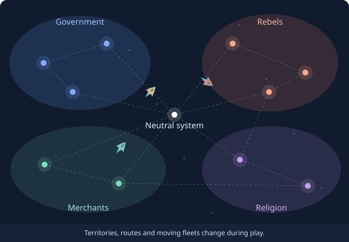

### 14-navigation-layout
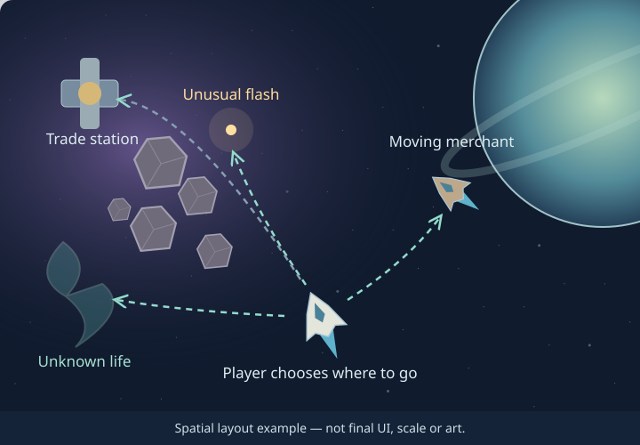

### 15-occlusion-detour
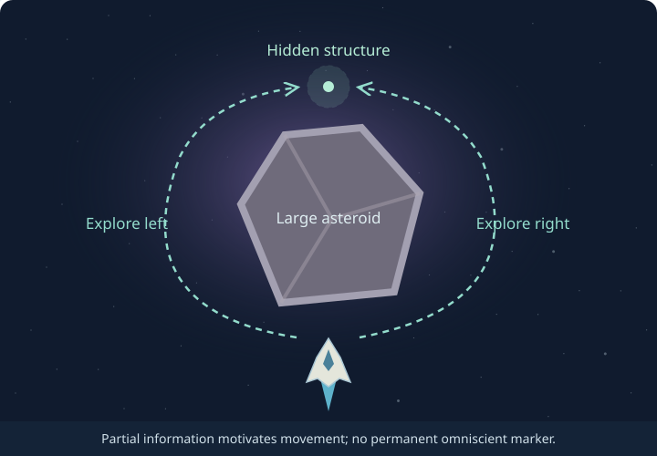

### 16-ship-anatomy-arcs
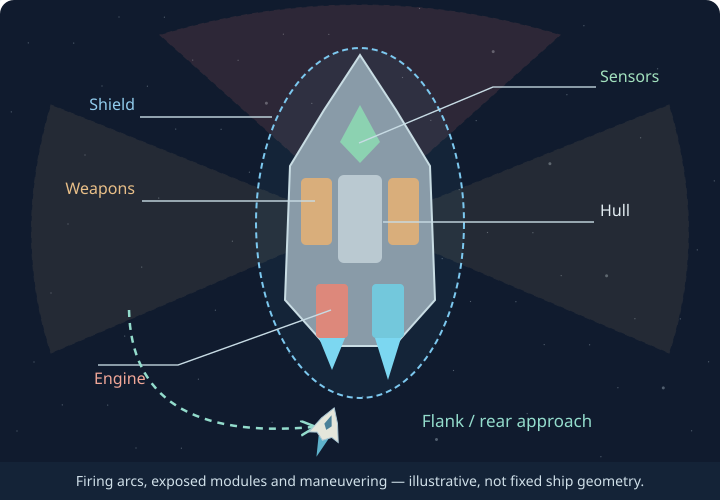

### 17-quarter-view-layout
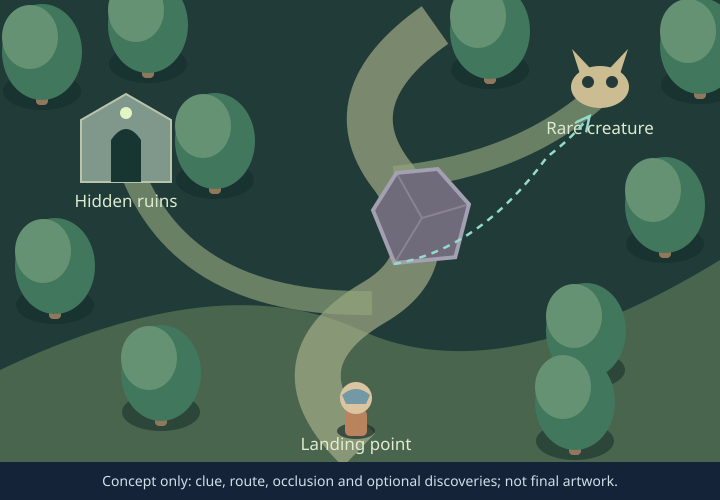

### 18-free-drag-gesture

## 19. Planet regions and procedural spaces

D19 승인 구조 설명. 실제 행성 크기·지도 배치·갱신 규칙 미확정. 지표가 지속되고 일부 공간에 절차적 생성 적용.

## 20. Ground exploration and real-time encounters

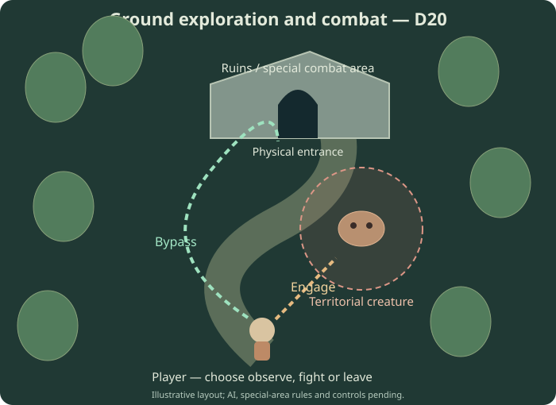

일반 교전/우회와 실제 유적 입구에 연결된 특수 구역. 자체 재구성 설명 도식이며 인게임 아트가 아님.

## 21. Manual ground controls + assistance

직접 이동·수동 공격과 제한 조준/연계 보조. 입력 충돌을 검증할 후보 도식이며 최종 UI 아님.

## 다음 시각 자료
행성 공간 구조 확정 후 실제 쿼터뷰 탐험 장면과 자유 드래그 항해 화면의 인게임 콘셉트, 모바일 조작 시안, 첫 10분 스토리보드를 사용자 검토용으로 제작하고 원본 파일을 저장. 사용자 승인과 구현 여부를 별도 표기.
