# VOID CARAVAN — 시각적 설명 도식 아틀라스
> 대화에 표시된 설명용 그림을 기반으로 **새로 재구성한 자체 SVG**. 원본 채팅의 SVG 픽셀 단위 복제나 완성 인게임 콘셉트 아님. 저장소 상대 경로로 보존되어 세션 종료 후에도 조회 가능. 영문 라벨은 이미지 렌더링 호환성 목적. GDD의 승인된 방향과 미결 사항을 설명한다.

[결정별 SVG·이미지 역색인](DECISION_VISUAL_INDEX.md) — 초기 SVG 번호 01–18은 결정 ID와 동일하지 않아 내용에 따라 매핑. 모든 자체 도식과 외부 자료의 연결 및 상태 확인.

## 01. 01-world-layers

연결: [D03](DECISION_VISUAL_INDEX.md#d03).

## 02. 02-faction-life

연결: [D04](DECISION_VISUAL_INDEX.md#d04) · [D05](DECISION_VISUAL_INDEX.md#d05).

## 03. 03-ship-controls
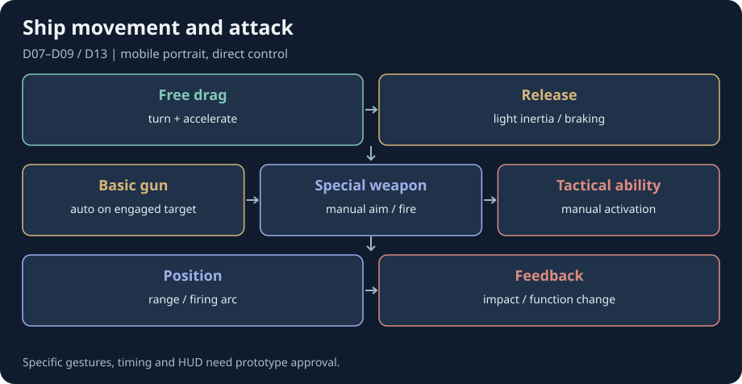

연결: [D07](DECISION_VISUAL_INDEX.md#d07) · [D08](DECISION_VISUAL_INDEX.md#d08).

## 04. 04-discovery-loop
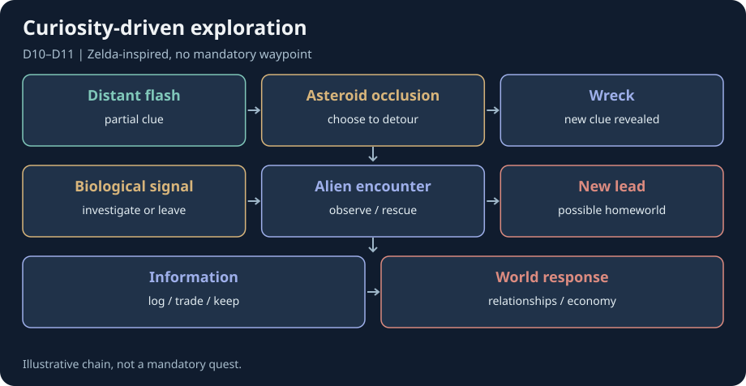

연결: [D10](DECISION_VISUAL_INDEX.md#d10) · [D11](DECISION_VISUAL_INDEX.md#d11).

## 05. 05-encounter

연결: [D12](DECISION_VISUAL_INDEX.md#d12).

## 06. 06-damage
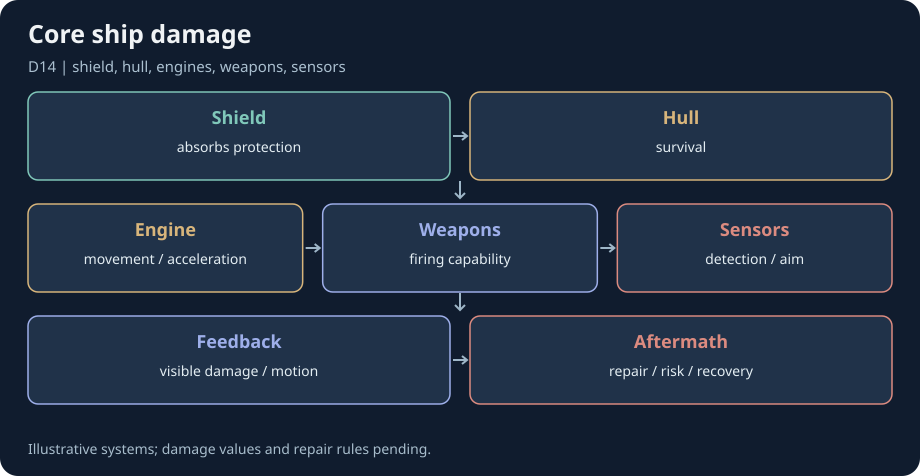

연결: [D14](DECISION_VISUAL_INDEX.md#d14).

## 07. 07-combat-outcomes
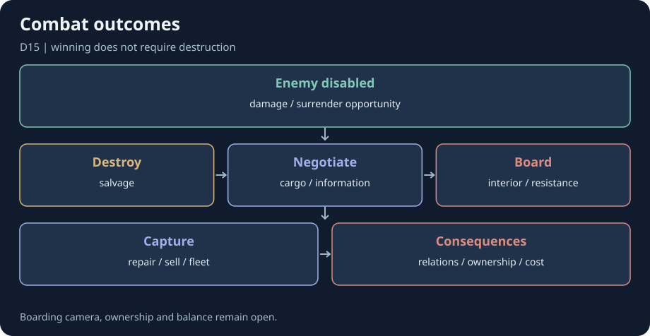

연결: [D15](DECISION_VISUAL_INDEX.md#d15).

## 08. 08-defeat
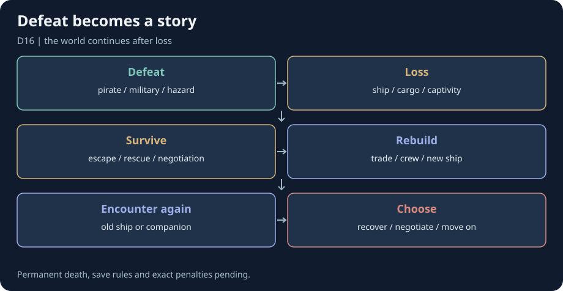

연결: [D16](DECISION_VISUAL_INDEX.md#d16).

## 09. 09-fleet

연결: [D17](DECISION_VISUAL_INDEX.md#d17).

## 10. 10-planet-exploration

연결: [D18](DECISION_VISUAL_INDEX.md#d18) · [D19](DECISION_VISUAL_INDEX.md#d19).

## 11. 11-information
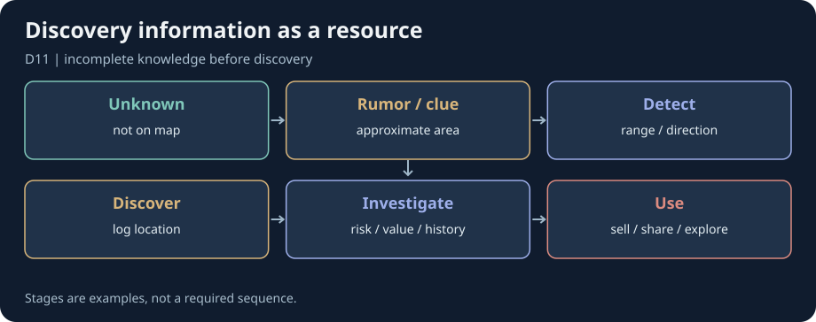

연결: [D11](DECISION_VISUAL_INDEX.md#d11).

## 12. 12-camera-comparison

연결: [D07](DECISION_VISUAL_INDEX.md#d07) · [D18](DECISION_VISUAL_INDEX.md#d18).

## 공간 배치 설명 그림 (대화 도식의 재구성)
### 13-galaxy-map

연결: [D03](DECISION_VISUAL_INDEX.md#d03).

### 14-navigation-layout

연결: [D03](DECISION_VISUAL_INDEX.md#d03) · [D07](DECISION_VISUAL_INDEX.md#d07) · [D08](DECISION_VISUAL_INDEX.md#d08).

### 15-occlusion-detour

연결: [D10](DECISION_VISUAL_INDEX.md#d10) · [D11](DECISION_VISUAL_INDEX.md#d11).

### 16-ship-anatomy-arcs

연결: [D13](DECISION_VISUAL_INDEX.md#d13) · [D14](DECISION_VISUAL_INDEX.md#d14).

### 17-quarter-view-layout

연결: [D18](DECISION_VISUAL_INDEX.md#d18).

### 18-free-drag-gesture
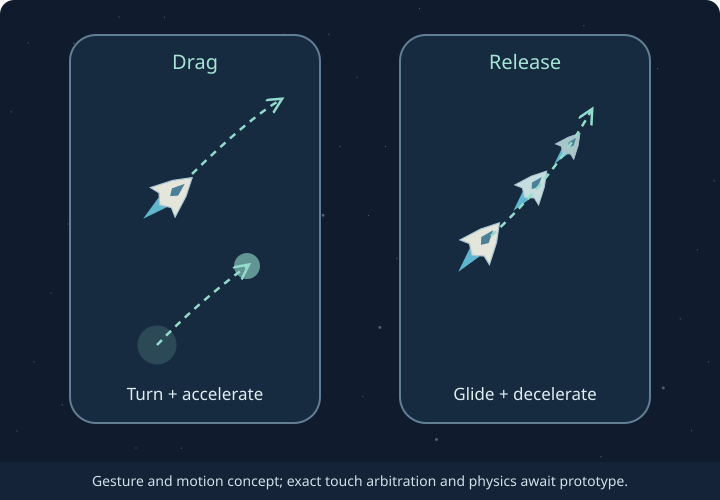

연결: [D08](DECISION_VISUAL_INDEX.md#d08).

## 19. Planet regions and procedural spaces

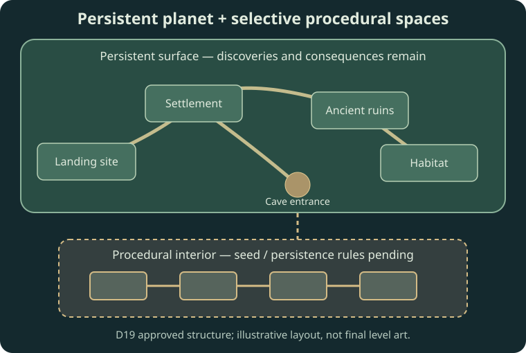

연결: [D19](DECISION_VISUAL_INDEX.md#d19).

D19 승인 구조 설명. 실제 행성 크기·지도 배치·갱신 규칙 미확정. 지표가 지속되고 일부 공간에 절차적 생성 적용.

## 20. Ground exploration and real-time encounters

연결: [D20](DECISION_VISUAL_INDEX.md#d20).

일반 교전/우회와 실제 유적 입구에 연결된 특수 구역. 자체 재구성 설명 도식이며 인게임 아트가 아님.

## 21. Manual ground controls + assistance

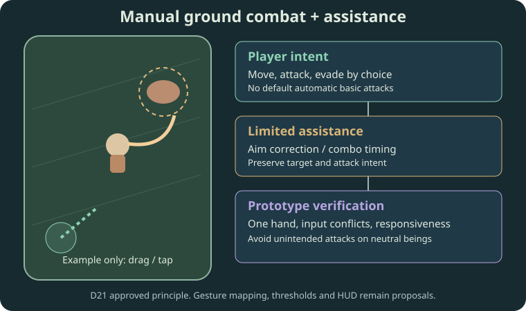

연결: [D21](DECISION_VISUAL_INDEX.md#d21).

직접 이동·수동 공격과 제한 조준/연계 보조. 입력 충돌을 검증할 후보 도식이며 최종 UI 아님.

## 22. Shared combat basics and differentiated styles

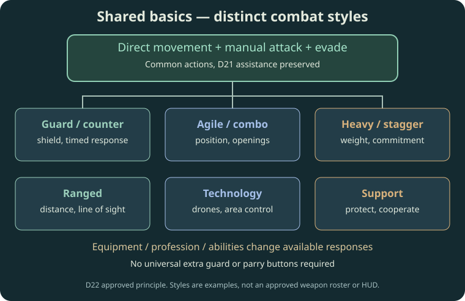

연결: [D22](DECISION_VISUAL_INDEX.md#d22).

공통 직접 공격·회피와 장비/직업별 대응. 스타일은 후보이며 확정 장비나 UI가 아님.

## 23. Differentiated impact and responsive input

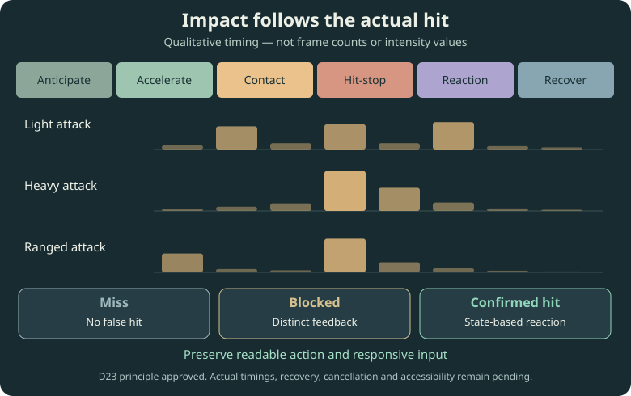

연결: [D23](DECISION_VISUAL_INDEX.md#d23).

공격 단계와 경량/중량/원거리의 정성적 리듬, 빗맞음/방어/명중 구분. 타이밍/강도의 실제 수치 아님.

## 24. Individual and population ecology

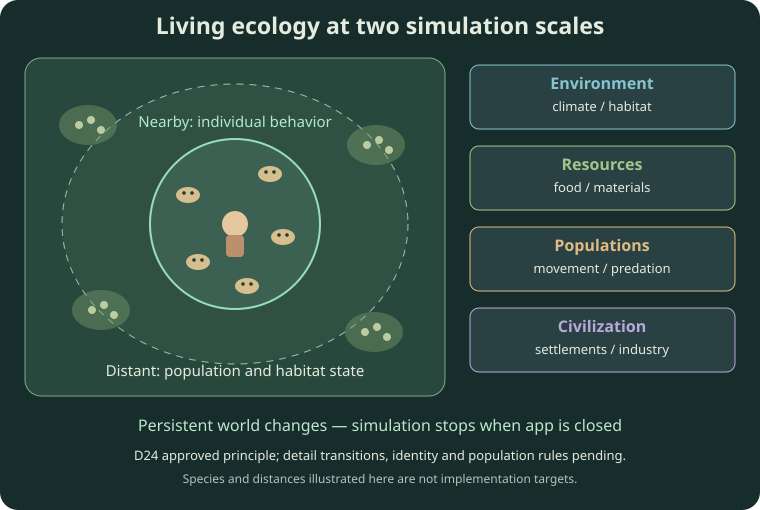

연결: [D24](DECISION_VISUAL_INDEX.md#d24).

근거리 개별 생명체/원거리 집단 상태와 환경·자원·문명 영향의 설명 도식. 반경·개체 수·종류는 예시.

## 25. Systemic environment and tools

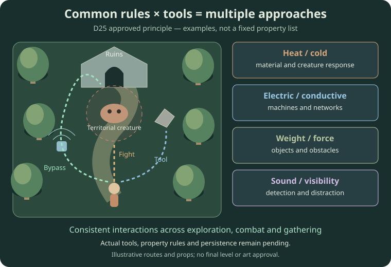

연결: [D25](DECISION_VISUAL_INDEX.md#d25).

제한 공통 환경 속성과 도구를 조합하여 정면 교전/우회/유인·도구 사용 등 복수 해결 방법을 제공하는 예시. 자체 재구성 도식, 확정 속성/장비/맵 아님.

## 26. Resource gathering

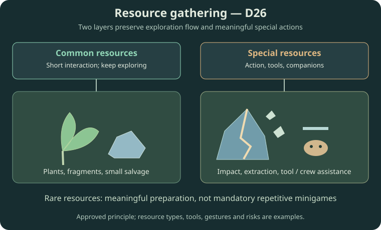

연결: [D26](DECISION_VISUAL_INDEX.md#d26).

일반 채집과 특수 채집의 차이. 도구/재료는 예시. STEP 4-16 채굴 피드백 설명의 재구성.

## 27. Resource transport and return

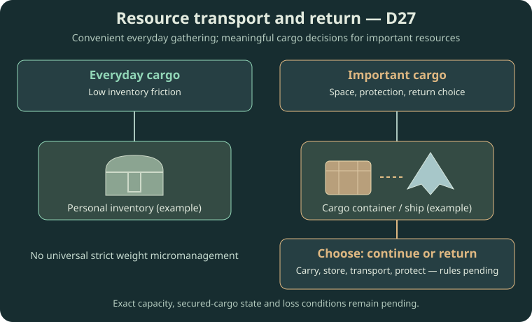

연결: [D27](DECISION_VISUAL_INDEX.md#d27).

일반 자원의 간편 소지와 중요한 화물의 보호/적재/귀환 선택. 확정 UI/수송/손실 규칙 아님.

## 28. Landing and conditional return

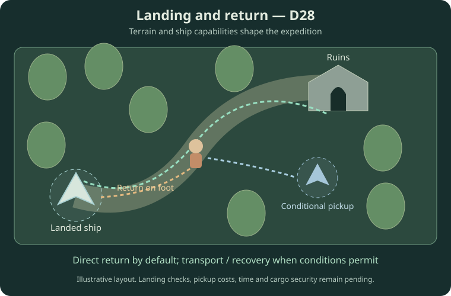

연결: [D28](DECISION_VISUAL_INDEX.md#d28).

함선 착륙과 직접 귀환, 조건부 수송/회수 개념의 자체 재구성 도식. 실제 착륙 맵/함선/회수 조건 미확정.

## 29. Discovery and exploration rewards

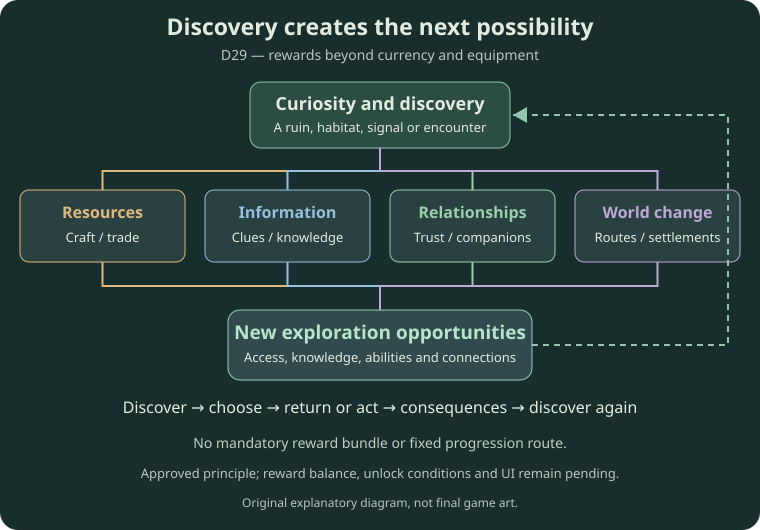

연결: [D29](DECISION_VISUAL_INDEX.md#d29).

발견→자원/정보/관계/세계 변화→새 탐험 기회. STEP 4 핵심 방향 종합 도식이며 순서/보상 묶음을 강제하지 않음. 실제 수치/화면 미확정.

## 30. Character creation recommendation flow

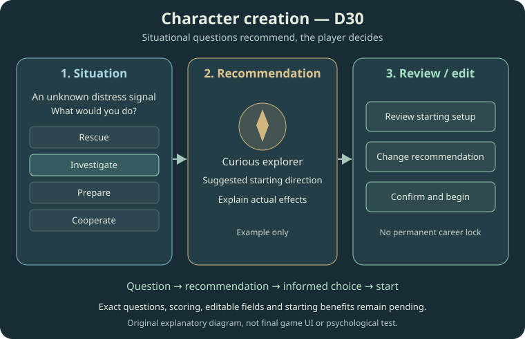

연결: [D30](DECISION_VISUAL_INDEX.md#d30).

성향 질문→추천→결과 확인·직접 수정. 앞선 인터랙션 시안의 원리 재구성. 질문/성향/결과 효과는 미확정이며 실제 게임 UI 아님.

## 31. Recommended starting profile and editable fields

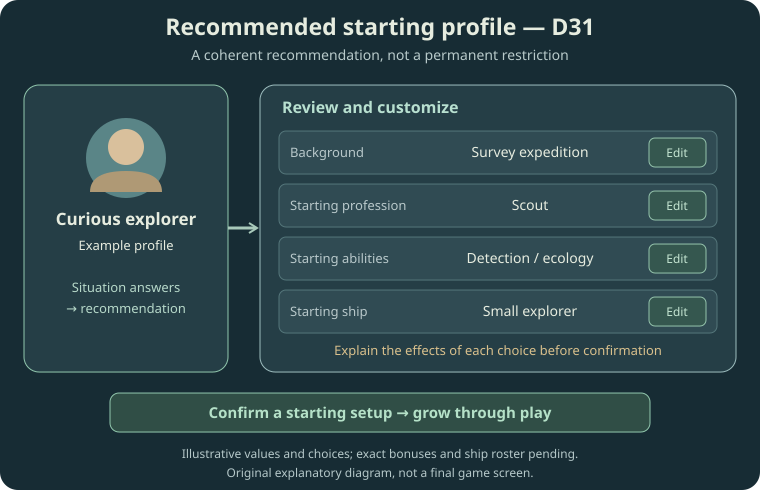

연결: [D31](DECISION_VISUAL_INDEX.md#d31).

성향 질문 기반 프로필과 배경/직업/초기 능력/함선 항목별 수정. 화면·수치·함선 목록은 예시이며 확정 UI 아님.

## 대화 이미지와 인터랙션 보존
- [이미지 검색 문구 원문](CHAT_IMAGE_INDEX.md) (원본 파일 미확보; 최신 수치는 manifest)
- [상세 예시 보존](EXAMPLE_ARCHIVE.md)
- [D30/D31 캐릭터 생성 HTML 재구성](prototypes/character-creation-example.html) · [데이터](prototypes/character-creation-example.json) — 원래 채팅 UI의 재구성, 실제 게임 화면 아님.

## 32. Starting ships (D32 구조 승인)

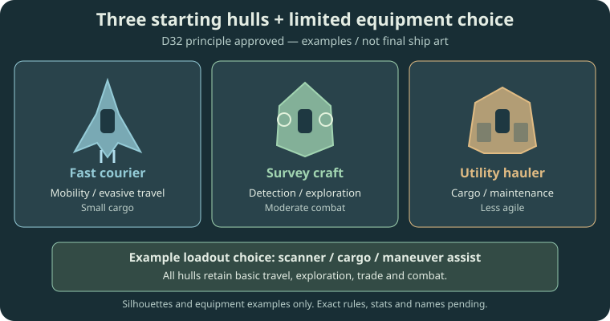

연결: [D32](DECISION_VISUAL_INDEX.md#d32).

3종 시작 함선과 제한적 장비 선택 비교. 자체 실루엣 설명 도식이며 3종+제한 장비 구조 승인. 실제 아트/함선 수치/세부 목록 승인 아님.

## 33. Cross-profession growth (D33 구조 승인)

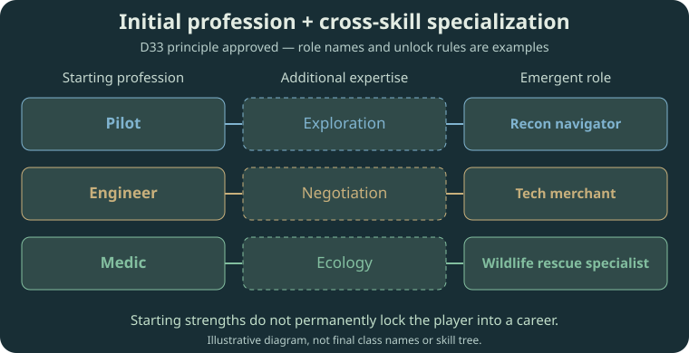

연결: [D33](DECISION_VISUAL_INDEX.md#d33).

초기 직업과 교차 기술을 조합하는 예시. 전문 직업 명칭·습득 규칙·능력치는 미확정.

## 34. Activity-based skill growth (D34 구조 승인)

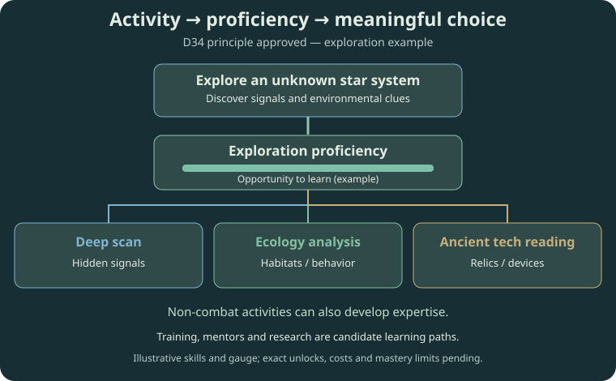

연결: [D34](DECISION_VISUAL_INDEX.md#d34).

활동→숙련→선택의 예시. [기술 선택 HTML 재구성](prototypes/skill-choice-example.html). 실제 기술 이름·조건·숙련 수치·UI 미확정.

## 35. Specialization profiles (D35 구조 승인)

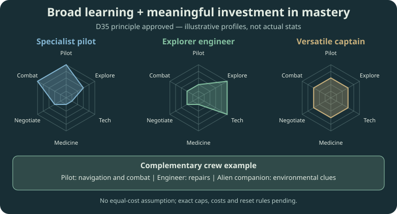

연결: [D35](DECISION_VISUAL_INDEX.md#d35).

전문화/교차 전문화/다재다능함의 예시 비교 및 동료 역할. 수치·상한·동일 비용 비교 아님.

## 36. Skill effects and multiple solutions (D36 구조 승인)
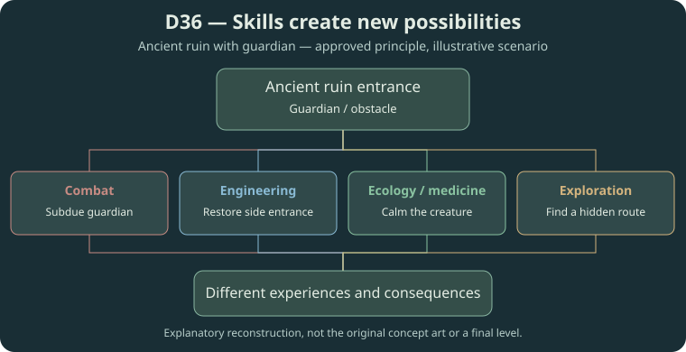
[결정·선호 이미지](DECISION_VISUAL_INDEX.md#d36). 자체 설명 도식. 외부 원본 미확보.

## 37. Equipment and skills (D37 구조 승인)
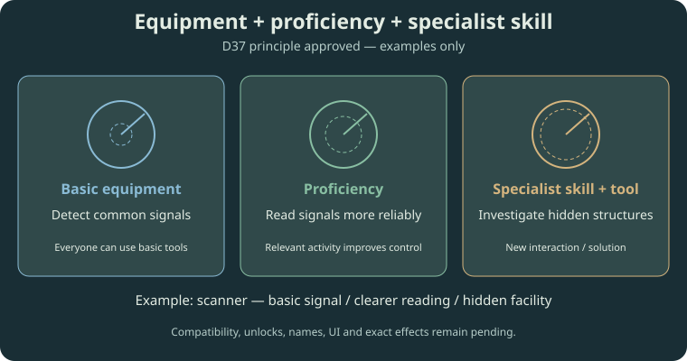
[결정·예시](DECISION_VISUAL_INDEX.md#d37). 스캐너의 기본 사용/숙련/전문 기술 조합 예시. 구조 승인; 구체 효과 미확정.

## 38. Companion identity and roles (D38 구조 승인)
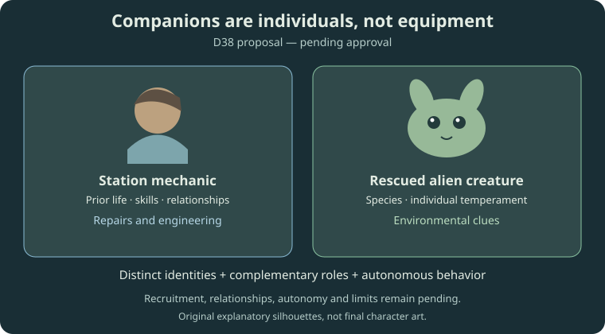
[결정·예시](DECISION_VISUAL_INDEX.md#d38). 개별 동료 정체성과 역할의 예시, 실제 캐릭터/아트/영입 규칙 아님.

## 39. Recruitment paths (D39 구조 승인)
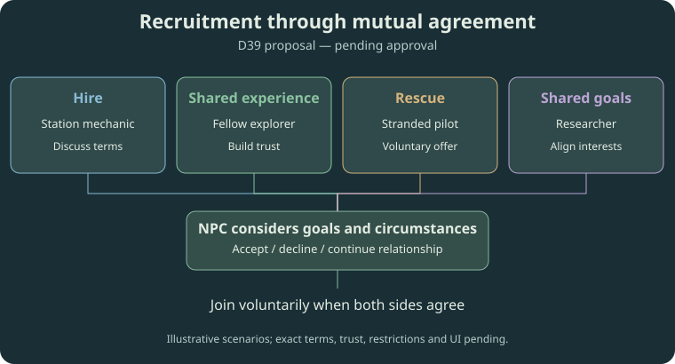
[결정·예시](DECISION_VISUAL_INDEX.md#d39). 여러 만남 경로와 상호 합의의 설명 도식, 실제 UI·영입 규칙 아님.

## 40. Alien bonding (D40 구조 승인)
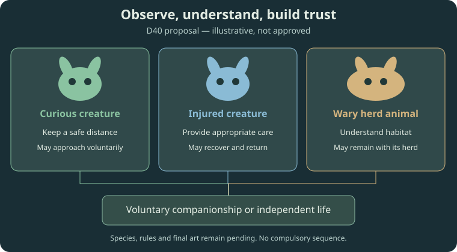
[결정·예시](DECISION_VISUAL_INDEX.md#d40). 생태 관찰, 적절한 교감 행동, 자발적 동행의 예시. 실제 종·아트·영입 규칙 아님.

## 41. Companion relationships (D41 구조 승인)
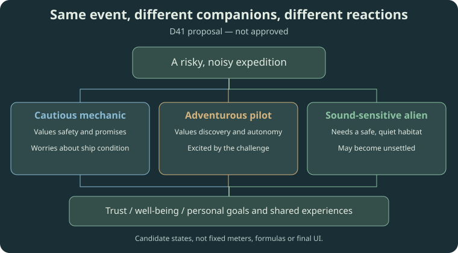
[결정·예시](DECISION_VISUAL_INDEX.md#d41). 동일 사건의 개체별 반응 비교, 실제 수치·UI·아트 아님.

## 42. Companion autonomy and commands (D42 구조 승인)
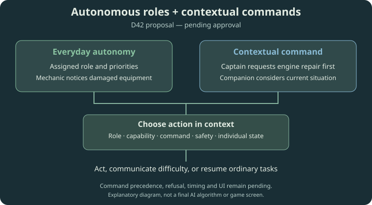
[결정·예시](DECISION_VISUAL_INDEX.md#d42). 역할/우선순위 및 상황별 명령의 설명 도식; 실제 AI·UI·아트 아님.

## 43. Companion deployment (D43 구조 승인)
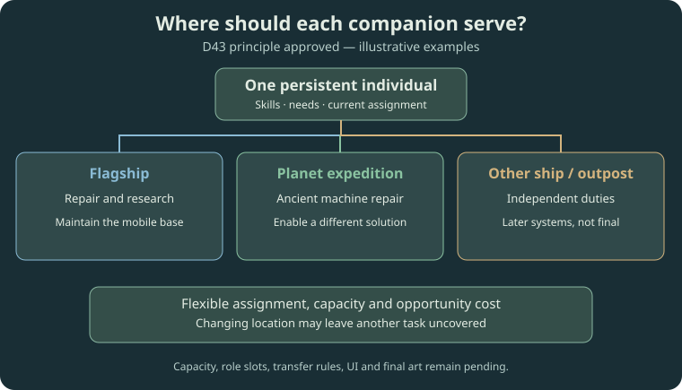
[결정·예시](DECISION_VISUAL_INDEX.md#d43). 함선·탐험·후속 독립 함대/거점 배치와 기회비용 설명 도식, 실제 UI·역할·슬롯 미확정.

## 44. Companion growth (D44 구조 승인)
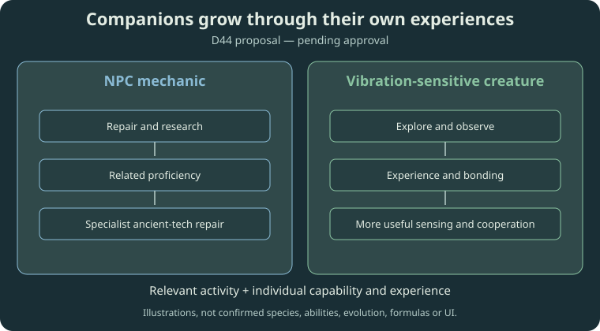
[결정·예시](DECISION_VISUAL_INDEX.md#d44). NPC와 외계 생명체의 성장 원리 비교, 실제 기술·수치·형태·UI 미확정.

## 45. Companion loss and recovery (D45 구조 승인)
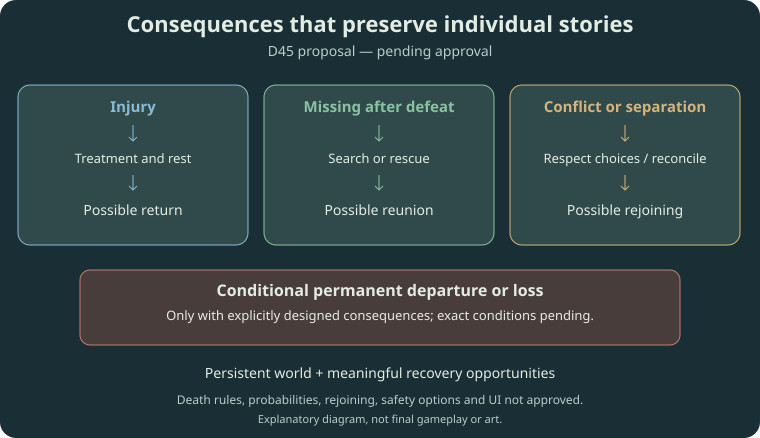
[결정·예시](DECISION_VISUAL_INDEX.md#d45). 부상·실종·갈등과 회복 기회, 조건부 영구 손실 후보 설명 도식; 구체 규칙 및 아트 아님.

## 46. Ship interior and management (D46 구조 승인)
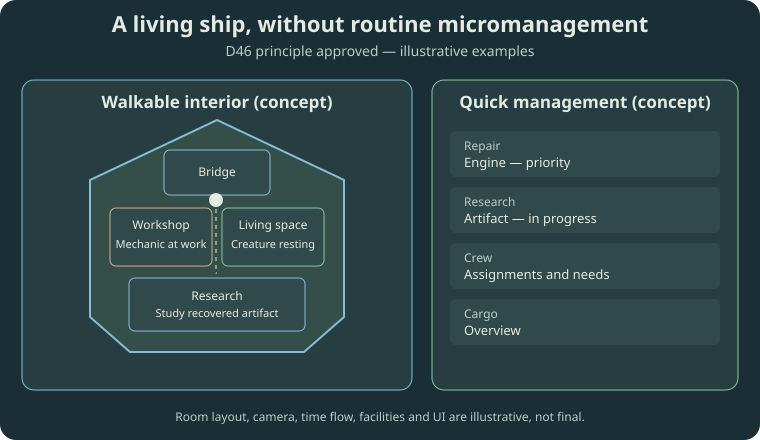
[결정·예시](DECISION_VISUAL_INDEX.md#d46). 생활하는 내부 공간과 간편 관리 접근을 비교한 자체 도식, 실제 카메라·시설·UI·아트 아님.

## 47. Ship interior camera (D47 구조 승인)
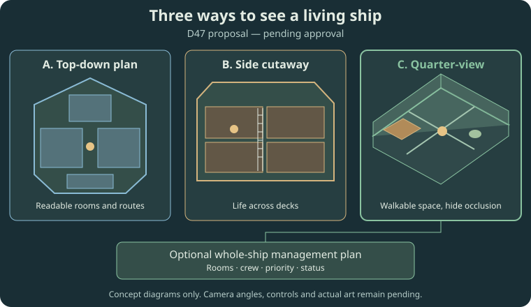
[결정·예시](DECISION_VISUAL_INDEX.md#d47). 탑다운·측면 단면·쿼터뷰 및 보조 배치도 비교. 최종 카메라·UI·아트 아님.

## 48. Ship facilities and expansion (D48 구조 승인)
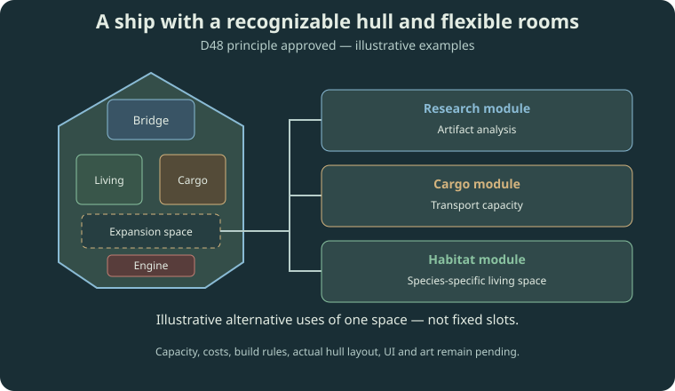
[결정·예시](DECISION_VISUAL_INDEX.md#d48). 모듈 교체·확장과 기회비용의 설명 도식. 실제 구조·슬롯·아트 아님.

## 49. Ship living conditions and survival (D49 구조 승인)
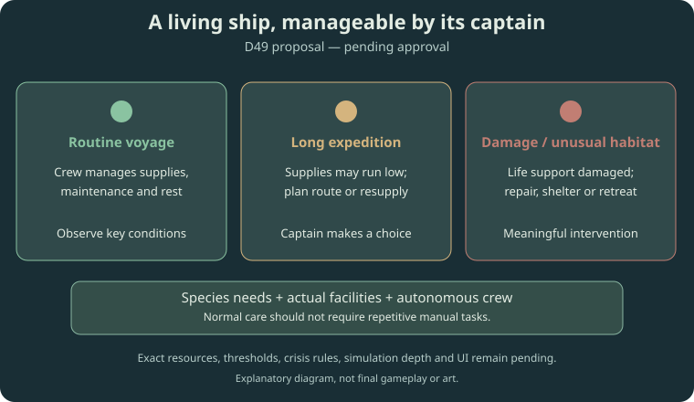
[결정·예시](DECISION_VISUAL_INDEX.md#d49). 평시 자율 관리, 준비 및 위기 대응의 구분; 실제 자원·수치·UI·아트 아님.

## 50. Mobile and fixed bases (D50 구조 승인)
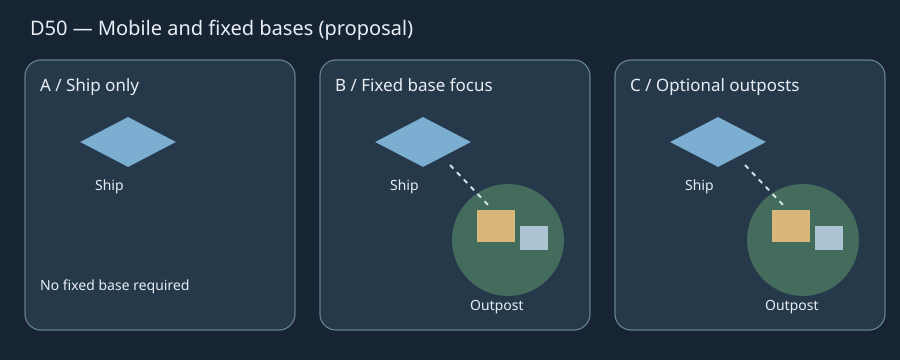
[결정·예시](DECISION_VISUAL_INDEX.md#d50). 이동식 함선과 선택적 고정 거점의 비교. 실제 아트·UI 아님.

## 51. Outpost acquisition and construction (D51 구조 승인)
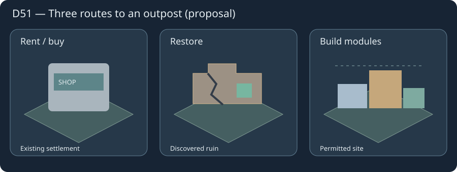
[결정·예시](DECISION_VISUAL_INDEX.md#d51). 임대·복구·신규 모듈 건설의 비교. 실제 아트·UI 아님.

## 52. Outpost operations and logistics (D52 미승인)
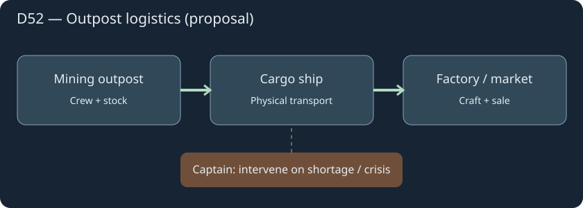
[결정·예시](DECISION_VISUAL_INDEX.md#d52). 자율 운영·수송·위기 대응 설명. 실제 아트·UI 아님.

## 다음 시각 자료
STEP 4 핵심 방향 확정 이후 실제 쿼터뷰 탐험 장면과 자유 드래그 항해 화면의 인게임 콘셉트, 모바일 조작 시안, 첫 10분 스토리보드를 사용자 검토용으로 제작하고 원본 파일을 저장. 사용자 승인과 구현 여부를 별도 표기.
